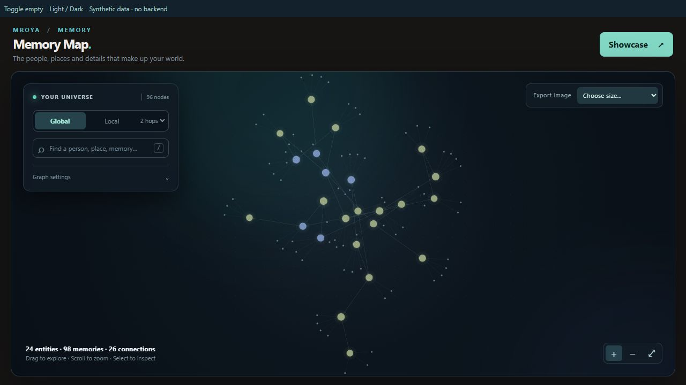
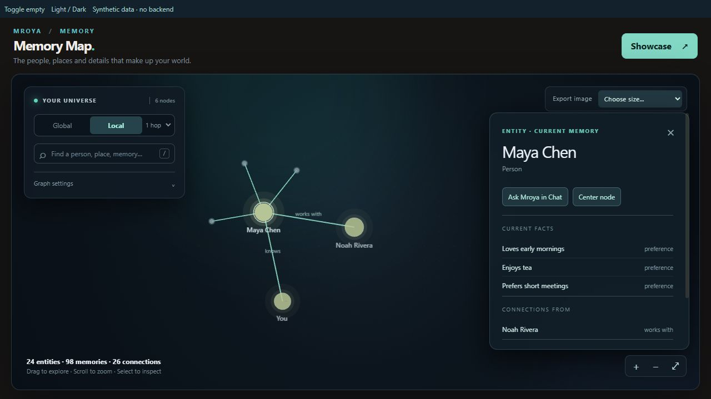
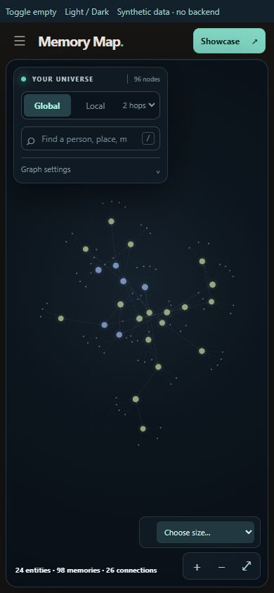
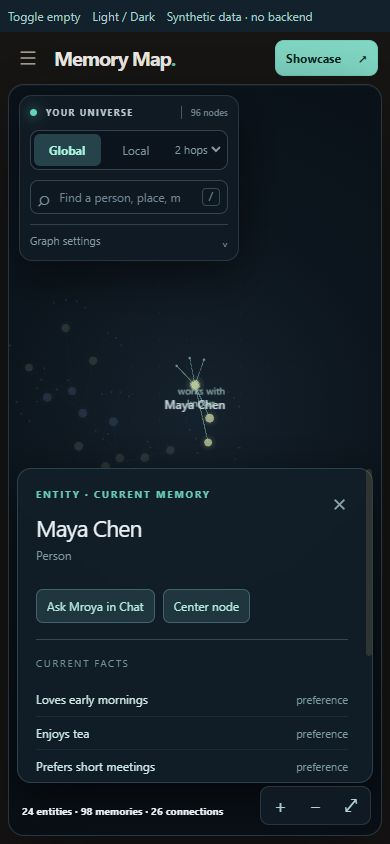
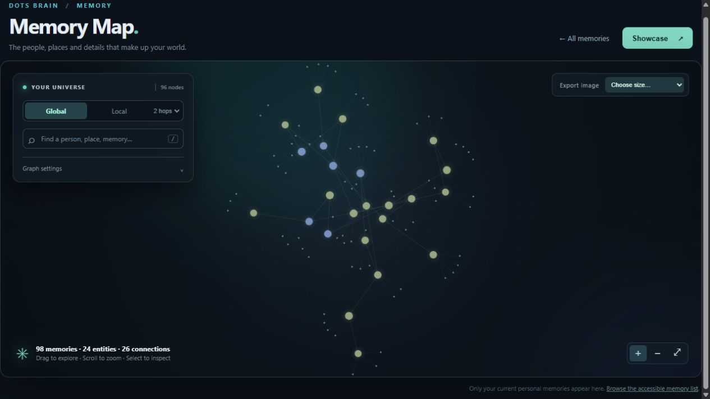

# Original Memory Map port

Source: [Personal-Memory-OS, commit 38892fa5e25e30c908e0c8ad5c2032d02d248d36](https://github.com/psiu7217/Personal-Memory-OS/tree/38892fa5e25e30c908e0c8ad5c2032d02d248d36).
Both repository main refs were checked before work; Web base is a30ba650eaa76f5bf2f3394c95bb2187ddab949c, and the old main is the source commit above.

## Source mapping

| Original | React integration |
| --- | --- |
| frontend/memory-map.js | src/components/memory-map/renderer.js: per-instance Pixi scene, original node/edge drawing, colors, highlight interpolation, label bands/collision suppression, camera, force simulation and PNG encoder |
| frontend/memory-map-graph.js | src/components/memory-map/graph.js: original Local/Hide Self/radius/PNG-header algorithms; typed presentation boundary |
| static/css/memory-map.css | src/components/memory-map/memory-map.css: original gradients, dots, halos, glass panels and controls, scoped under .mroya-memory-map with isolated animation names |
| templates/memory/map.html | src/components/MemoryMapView.tsx: React-owned controls and details, preserving existing Workspace callbacks |
| frontend/memory-map-graph.test.js | tests/memory-map-graph.test.mjs: original four pure regression tests |

Dependencies match the old renderer: **pixi.js 8.22.0**, **d3-force 3.0.0**. @types/d3-force is a development-only typing dependency. Existing dependency versions are retained; package-lock.json and the existing Studio fallback lock contain the same dependency graph. No generated old bundle or old backend code is included.

## Behavior and data

The existing GET /api/v1/memories/map/ remains the sole live source. The adapter preserves entity/memory type, kind, is_self, degree, memory_count, subject, statement_id, predicate/polarity/literal type, validity/provenance metadata and canonical edge IDs/endpoints. It no longer assigns radial coordinates. The existing Workspace truncated notice is retained.

Each mount creates one Pixi application. React re-renders and global selection do not recreate it or restart physics. Dataset/Local/Hide Self changes rebuild the visible simulation on separate copies while retaining known positions. Original tuning is retained: repulsion 235 (memory multiplier .33), distance 126 (memory multiplier .55), link strengths .35/.5, collision padding 13/7 with two iterations, center .028, velocity decay .36, alpha decay .035 and original 35–180 initial settling ticks. Selection only changes visual targets in Global mode.

Native pointer capture replaces the old global event handlers: mouse/touch pan, node drag and two-pointer pinch stay inside the instance; cursor-relative wheel zoom, fit, center, hover/tooltip, search, Global/Local 1–2 hops, applicable Hide Self and force sliders are available. Reduced motion stops ongoing simulation and skips visual/camera transitions. Cleanup stops simulation, animation frames, ResizeObserver, pointer/media listeners, Pixi resources and temporary export URLs, including an initialization that finishes after unmount.

Panels show actual facts, incoming/outgoing links, memory values and available metadata. Open Memory is offered only for an existing linked memory/statement ID. Ask Mroya uses the existing callback; no business action or new API is added. The same component and renderer use local Studio fixtures in Design Mode; the renderer contains no transport, storage or old-server calls.

## Visual review

Screenshots use **one synthetic graph** for both original and ported renderer: 24 entities, 72 literal memories, 98 edges, several clusters. The original renderer was run locally from source with a small harness in place of Django (local JSON only). Its harness adjusts page height/overflow to fit the review viewport. The old live site requires login, so no production account or personal data was used.

For an interactive repository preview: npm ci, then npm run dev, choose Memory Map in the sidebar. This uses the existing offline Studio fixtures and the same renderer. Production builds retain real-source isolation.

## Checks and limits

- TypeScript, Production build, Design build, boundary/credential checks and production bundle verification pass.
- Six targeted tests pass: original graph algorithms plus metadata/ID preservation, missing-edge handling and simulation non-mutation.
- Browser smoke: zoom, pan, drag, search, selection, Local 1/2 hops, force controls/Hide Self, empty graph, Full HD PNG header verification, Showcase, Light/Dark and 390×844 viewport without horizontal overflow. Full Design Workspace Open Memory and Ask Mroya transitions work locally. Blocking WebGL produces the controlled error state.
- No full suite, paid provider calls, production data changes, backend changes, merge or deployment.

Differences are limited to the host integration: Mroya branding/header and existing actions, a smaller heading inside Workspace, scoped Showcase instead of changing document/body or hiding the shared sidebar, and a mobile camera offset to keep the selected node above the bottom panel. The canvas retains the original dark palette in both themes. PNG export uses the original separate 2D snapshot of the current visible graph, not an exact screenshot of the interactive camera. Full HD/QHD/4K/square resolutions remain available; only Full HD was browser-smoked. Bundle-size warning (>500 kB) remains; Pixi adds weight. Large production graphs and physical-device multi-touch were not exhaustively tested.
