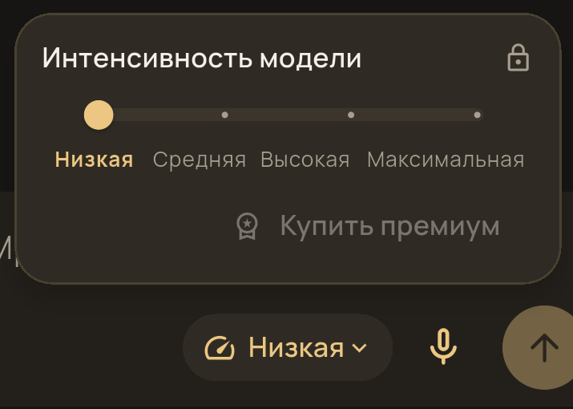

# Компактная шкала интенсивности в чате

В вебе после [PR #97](https://github.com/psiu7217/Mroya-web/pull/97) кнопка с иконкой шкалы открывает вертикальный список с английскими уровнями и сообщением о недоступности выбора. В мобильной Мрое владелец утвердил компактную карточку над кнопкой. Перенести этот вариант в веб-композер. [Мобильный PR #32](https://github.com/psiu7217/Mroya-mobile/pull/32), [мобильный PR #33](https://github.com/psiu7217/Mroya-mobile/pull/33).

## Критерии приёмки

- Кнопка рядом с микрофоном показывает шкалу, текущий уровень и стрелку раскрытия. Уровень по умолчанию — «Низкая» / Low.
- Над кнопкой открывается компактная карточка с четырьмя отметками на одной горизонтальной шкале. Первая отметка выделена. Уровни «Низкая», «Средняя», «Высокая», «Максимальная» локализуются как Low, Medium, High и Max.
- Шкала показывает уровни в режиме предпросмотра. В текущем контракте чата отсутствует параметр выбора интенсивности, поэтому запрос отправки сообщения использует прежний payload.
- Внизу карточки отображается отключённая кнопка «Купить премиум» / Buy Premium. Она не ведёт к оплате. Прежнее сообщение «Выбор уровня пока недоступен» убрано.
- Карточка помещается в доступную область на узком экране, учитывает открытую клавиатуру, сохраняет черновик и закрывается по Escape либо нажатию вне неё. Проверить доступное имя кнопки, объявление текущего уровня и возврат фокуса при закрытии с клавиатуры.
- Проверить русский и английский, светлую и тёмную темы, мобильную и настольную ширину. Расположение вложений, режима изображения, микрофона и отправки сохраняет сценарии веб-композера из PR #97.

Начать с блока `effort` в `src/components/ChatWorkspace.tsx` и локалей `src/i18n/locales/{ru,en}/chat.json`.
