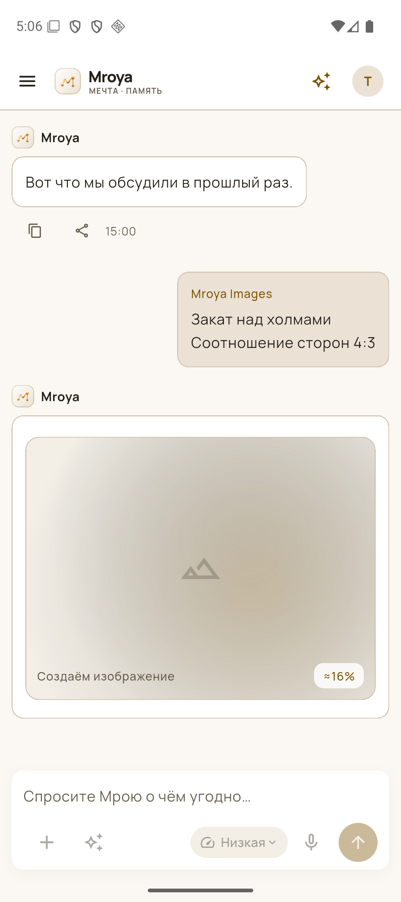

# Ожидание ответа и генерация изображения

В вебе уже есть анимированная карточка с оценочным процентом из [PR #91](https://github.com/psiu7217/Mroya-web/pull/91). Если текст ответа ещё пуст, композер из [PR #97](https://github.com/psiu7217/Mroya-web/pull/97) одновременно показывает три точки. В утверждённом мобильном варианте это последовательные этапы. Нужно согласовать отображение в веб-чате с [мобильным PR #34](https://github.com/psiu7217/Mroya-mobile/pull/34).

## Критерии приёмки

- Пустой потоковый ответ показывает три точки, пока сервер не сообщил о запуске инструмента `generate_image`. Правило работает и для обычного сообщения, если Мроя сама начинает рисовать в ответ.
- При запуске генерации три точки скрываются, а в сообщении появляется заглушка в форме изображения с плавным движением фона. Снизу слева виден статус, справа — читаемый бейдж `≈N%`. Использовать цвета и скругления Мрои. Мобильный пример использует карточку 4:3 и один числовой индикатор.
- Оценка растёт по времени и ограничена ниже 100% в фазе генерации. Сохранить локализованное доступное описание оценки. Точное 100% допустимо после подтверждения успеха сервером. При настройке «уменьшить движение» фон статичен.
- После прихода готового изображения заглушка исчезает и работает существующий просмотр. При ошибке или прерывании анимация и таймер останавливаются, а чат показывает штатный результат обращения. Обычный текстовый ответ сохраняет поведение трёх точек до появления текста.
- Проверить на тестовом SSE-потоке последовательность «ожидание → генерация → готовое изображение», прерывание, узкий экран, светлую и тёмную темы и настройку уменьшенного движения.

Использовать существующие `ChatWorkspace.tsx`, `ImageGenerationCard.tsx` и `src/utils/imageGeneration.ts`. Сохранять текущий API и просмотрщик изображений.
