# Mroya mobile visual audit

## Scope and coverage

Mroya is a single page workspace: its main areas are selected inside the application rather than exposed as separate URL routes. I inspected the current `main`-based branch in Design Mode and checked the visible screens in both English and Russian.

The mobile viewport matrix was 320×700, 360×800, 375×812, 390×844, 430×932 and 768×1024. Desktop checks covered 1280×900 and 1440×1000. The `before` folder holds 141 source screenshots; `after` holds 395 retained screenshots from the final review. The folders include page captures, menu and dialog states, long-content views, empty/loading/error states, and desktop references. Layout measurements are in [metrics-before.json](metrics-before.json) and [metrics-after.json](metrics-after.json).

### Pages and interface areas inspected

- Guest entry, welcome, typing, invitation prompt, sign-in form and Google sign-in button in the offline design scenarios. No registration page or registration route exists in the current application.
- Chat composer, long conversation, failed assistant response, saved-memory response, scroll position and conversation history.
- Chat history search, mobile navigation, conversation actions, rename/delete menu and delete confirmation.
- AI Tasks drawer: active, completed and error tabs.
- Calendar month view, month/year picker, event detail, new/edit event forms, delete confirmation, connected-calendar panel and linked reminders.
- Reminders list, search, wrapping filters, standalone and calendar-linked reminders, completed section, add/edit forms and bottom-of-list actions.
- Notes list, search and categories, long note reading view, empty state and header preview controls.
- Memory cards, categories, search, selected-memory detail, add/edit forms and Memory Map links.
- Memory Map global/local graph modes, search, depth selector, graph settings, selected-node panel, zoom controls and presentation mode.
- Connections and Account tabs: Connections, Plan, Appearance, Profile (including language and timezone controls), and Assistant preferences. Connection-state samples were viewed without performing real connections or syncs.
- User account menu, plan preview, theme control, loading/error/empty workspace scenarios and the guest state variants shipped by Design Mode.

## Findings fixed

- The Reminders heading and full create button collided at 320 px. The narrow layout now uses a compact, localized create action and retains an accessible name. Reminder card actions move below the text on small screens, leaving room for dates and descriptions.
- Reminder and Notes filter chips were hidden in horizontal overflow. They now wrap so the filters remain visible and selectable.
- The Calendar new-event dialog hid its save controls on short screens. Calendar event, reminder editor, memory editor and plan preview surfaces now use the dynamic viewport height and internal vertical scrolling. Dialogs retain visible actions at the bottom of the form.
- Russian Calendar category labels did not fit in the three-column event form. On phone widths the choices use two columns, with the third choice spanning the row. Both new and edit event forms use the same layout.
- Calendar month picker and long event detail panels now stay within the viewport and scroll internally. Event detail dates, times, all-day text and duration use the active locale; the month picker label is translated.
- At 768 px, Memory had no visible way to open navigation because its mobile menu button was hidden at the desktop breakpoint. The button is now available through tablet widths.
- The selected Memory Map node panel covered the stats and zoom controls on short phones. The panel now sits above the controls with a bounded height.
- Connections sub-tabs no longer disappear off the side on mobile/tablet; they wrap below the desktop breakpoint. Long profile email addresses wrap instead of truncating.
- Notes preview controls no longer overlap the title on narrow screens, and category chips wrap. The “All” category control now uses the English or Russian translation.
- Long conversation titles in the sidebar and deletion prompt wrap on phones. Desktop titles keep their existing compact presentation and expose the full title through the native title attribute.
- AI Tasks controls and labels now use the active locale instead of hard-coded Russian strings.

## Before and after screenshots

### Reminders heading, card text and actions

Before: the create action collided with the title and left the reminder content very little width. After: the heading fits and card actions have their own row.

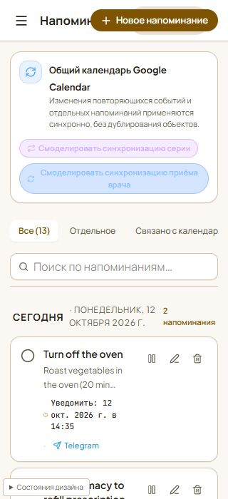

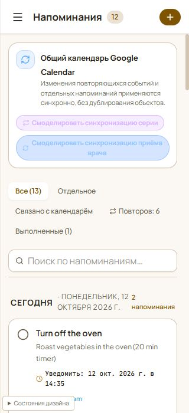

### Calendar event form at 320 px

Before: the form's lower actions were outside the usable viewport, and the Russian category label ran past its button. After: the form scrolls to its actions and the long category receives a full-width row.

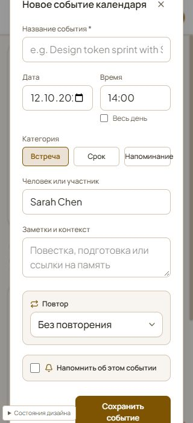

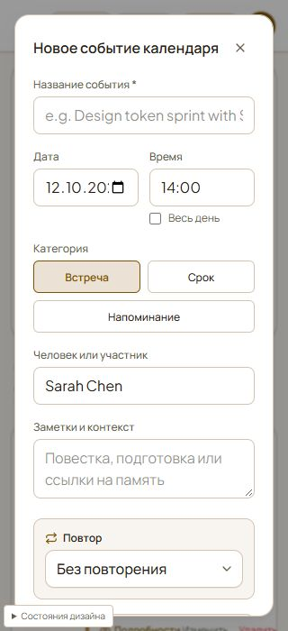

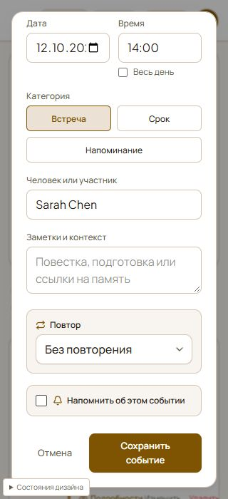

### Memory navigation on a tablet

Before: the Memory screen had no navigation button at 768 px. After: the menu button is visible and the opened menu gives access to every section.

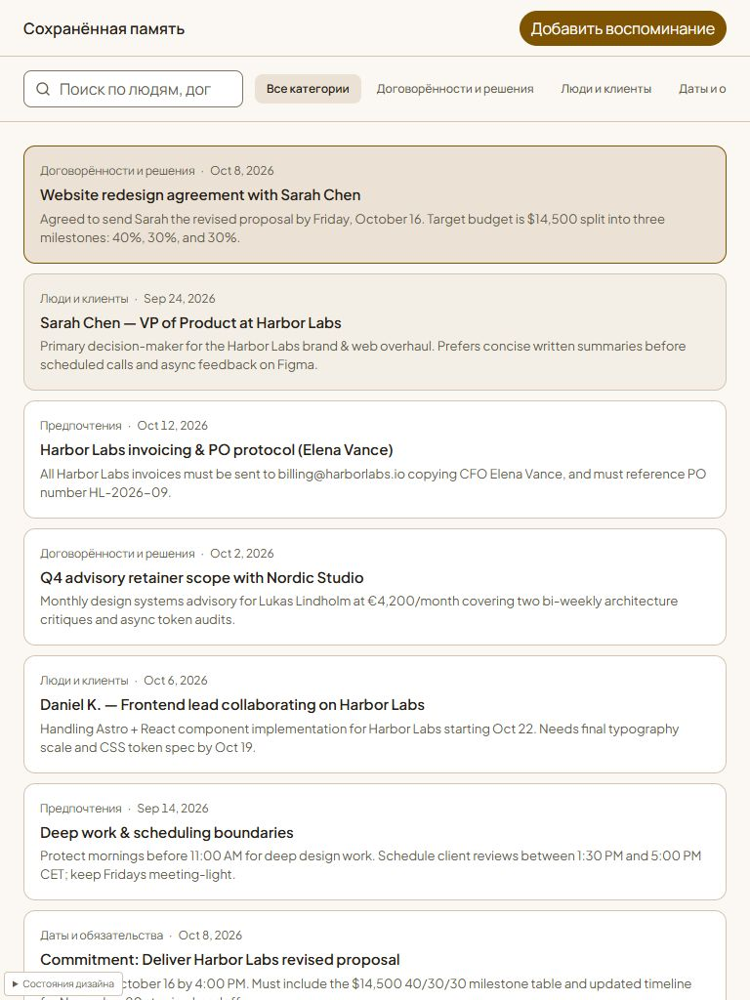

### Memory Map controls

Before: selected-node details covered the graph statistics and zoom controls on a short phone viewport. After: the details panel ends above those controls.

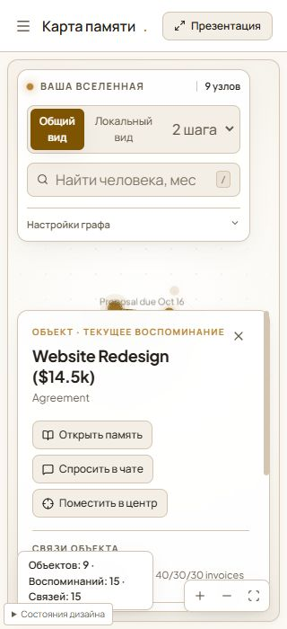

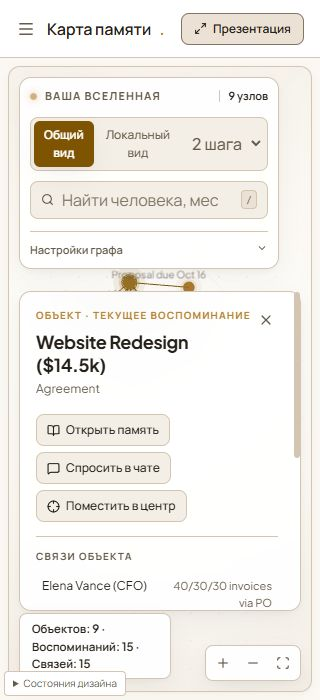

### Navigation tabs and Notes filters

The mobile Connections tabs wrap into reachable rows, and Notes filters wrap while their “All” label follows the selected language.

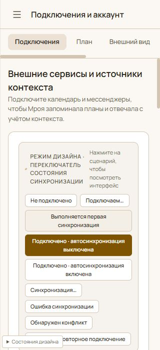

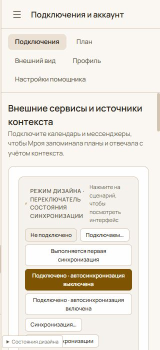

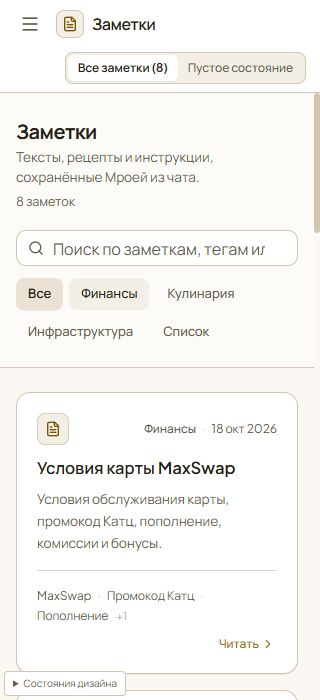

## Final visual verification

The retained after-capture measurements cover all six requested mobile widths and both locales, plus 1280 px and 1440 px desktop checks. The document and body widths matched the viewport in every recorded after state; there was no page-level horizontal overflow. Internal scrolling remains on intentionally scrollable content such as long forms and dialogs.

All source and final screenshots remain in the repository under [screenshots/before](screenshots/before/) and [screenshots/after](screenshots/after/). The after set also includes state-specific captures such as calendar event detail/edit/delete, reminder edit, note detail, chat history actions and delete prompt, AI Tasks tabs, account menu, plan preview, Memory editing and presentation mode, plus guest/auth states.

## Screens not available in this review

- A real authenticated account session was not available in the project's offline Design Mode. Production login, account data and live API-backed variants therefore could not be opened; no credentials were entered and no real user data was read or changed.
- The guest login and welcome screens were inspected through the shipped design scenarios. The source contains no separate registration page or route.
- Google OAuth, actual calendar sync, Telegram delivery and other external connection flows were represented by Design Mode samples only. No external account or message action was invoked.
- The browser tool provided desktop browser emulation at mobile viewport sizes, not a physical phone. The native mobile keyboard and its viewport resize behavior could not be observed directly.

## Technical checks

- `npm run lint` — passed (`tsc --noEmit`).
- `npm run build:production` — passed. Vite reports the existing main JavaScript chunk at about 1.16 MB, above its 500 kB advisory threshold.
- `npm run check:boundaries` — passed.
- Focused localization and Notes tests — passed (9/9): `tests/localization.test.ts` and `tests/notes-view.test.mjs`.
- `npm test` — failed: the repository's complete Node test suite is not green. The run reports 391 passing and 40 failing tests. Failures include direct React component calls that throw `Cannot read properties of null (reading 'useState')`, AI Task assertions, and a notification test that cannot load `src/components/IntelligencePreviews.tsx`. These are not responsive layout assertions; this audit did not change API or business behavior.
- Navigation smoke: opened each workspace section and its relevant menu/form states in the browser. No real backend action was sent. One “forget memory” action in the offline Design Mode removed a sample card without a confirmation; reloading the scenario restored the original fixture. All other potentially destructive demo actions were cancelled.
